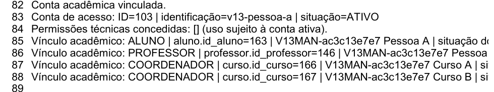

# SCOA — Sistema de Controle Acadêmico

Protótipo acadêmico em **Java e MySQL**, desenvolvido para Engenharia de Software no Bacharelado em Sistemas de Informação do CEFET/RJ, campus Maria da Graça. O projeto reúne requisitos, modelos de software e uma implementação incremental dos processos acadêmicos em console.

**Entrega atual: v0.13 validada e fechada em 24/11/2026.** O autor aprovou **130 testes unitários, 194 de integração e os seis casos manuais** desta iteração. O sistema mantém uma conta de acesso com vários vínculos acadêmicos legítimos e separa essa identidade das permissões técnicas. O módulo acadêmico completo e a interface web continuam em desenvolvimento.

[Documentação atual](docs/README.md) · [Relatório da v0.13](docs/testes/publicados/execucao_autor_v0_13/RELATORIO.md) · [Capturas reais](docs/testes/publicados/execucao_autor_v0_13/CAPTURAS.md) · [Evolução por versão](CHANGELOG.md)

## O que já funciona

| Frente | Comportamento disponível no console |
| --- | --- |
| Base acadêmica | Alunos, professores, cursos, disciplinas, pré-requisitos, estrutura curricular, períodos e turmas. |
| Salas e horários | Cadastro, disponibilidade e alocação com verificação de capacidade e conflitos. |
| Matrícula e inscrição | Histórico institucional, elegibilidade, duas fases de inscrição, controle de vagas e confirmação do próprio aluno. |
| Ajustes acadêmicos | Cancelamento automático ou por decisão da coordenação, renovação institucional e retificação de resultado com histórico. |
| Reconhecimento e planejamento | Equivalência manual, conciliação de legado, revisão de reconhecimentos e simulação por ofertas. |
| Acesso e consultas | Autenticação, permissões dos fluxos protegidos, vínculos acadêmicos e consulta dos próprios horários e resultados finais. |

## O que mudou na v0.13

A escolha repetida de ALUNO/PROFESSOR/COORDENADOR na criação de conta foi eliminada. Esses papéis são obtidos dos vínculos; o acesso técnico é concedido separadamente. A mesma conta pode reunir aluno, professor e coordenação de vários cursos sem receber permissão administrativa por esse motivo. O provisionamento identifica claramente qual campo pede ID da conta, do aluno, do professor ou do curso.



*Recorte de uma execução real do autor, com dados sintéticos. A [galeria](docs/testes/publicados/execucao_autor_v0_13/CAPTURAS.md) reúne as demais verificações e os CSVs correspondentes.*

## Como a entrega foi verificada

| Execução independente | Unitários | Integração | Resultado |
| --- | ---: | ---: | --- |
| Autor, 23/11/2026 | 130 | 194 | BUILD SUCCESS; zero falhas, erros ou ignorados. |
| Codex, 23/11/2026 | 130 | 194 | BUILD SUCCESS; zero falhas, erros ou ignorados. |
| Casos manuais do autor, 23 e 24/11 | — | — | Seis casos concluídos; 26 CSVs e oito PDFs preservados. |

São duas execuções da mesma bateria, identificadas separadamente. A seleção pública da v0.13 contém **seis imagens de console e 20 CSVs sintéticos**, acompanhados de relatório, resultados por classe e manifestos. [Veja as evidências](docs/testes/publicados/execucao_autor_v0_13/CAPTURAS.md).

## Executar e testar

O projeto utiliza Java 25, Maven 3.9.11, JUnit Jupiter 6.0.1, MySQL Connector/J 26.7.0 e MySQL 8.0. A execução validada usou MySQL 8.0.46.

```powershell
# Testes unitários
.\mvnw.cmd test

# Regressão com MySQL, após preparar a conexão de testes
.\mvnw.cmd verify -Pmysql-it
```

Os testes JDBC exigem `SCOA_TEST_DB_URL`, `SCOA_TEST_DB_USUARIO` e `SCOA_TEST_DB_SENHA`, configurados localmente, apontando exclusivamente para **scoa_java_teste**. A base usa o [DDL de testes v7.5](database/tests/SCOA_MySQL8_schema_v7_5_java_teste.sql) e as [migrações V006 a V012](database/migrations), nessa ordem. Bases existentes precisam de conferência e backup; não recriar ou reaplicar migrações automaticamente. São 87 tabelas após V012. A v0.13 não acrescenta migração e não migrou o schema `scoa`.

Para o console, execute `br.edu.cefetmg.scoa.ScoaAplicacao` com `SCOA_DB_URL`, `SCOA_DB_USUARIO` e `SCOA_DB_SENHA`. A inicialização da primeira conta é local e explícita, sem senha padrão. Dados de conexão, senhas e guias operacionais são privados.

## Organização e limites

`src/main/java` contém domínio, aplicação, persistência e apresentação; `src/test/java` reúne os testes. `database` contém DDL e migrações. O [índice de docs](docs/README.md) separa a modelagem de referência, as notas de implementação e as evidências por versão.

Autorização global dos menus legados, primeiro lançamento autenticado de resultados, avaliações e frequência por aula, diário de classe, transferências, integralização, histórico escolar próprio consolidado, interface web e os demais módulos continuam pendentes. A apresentação está prevista para **30/11/2026** e a entrega para **07/12/2026**; o [plano atual](docs/SCOA_Plano_Entrega_2026_11_23.md) identifica o recorte e as dependências.

O PDF v7.5 em `docs` é a base histórica de requisitos e modelagem. Para saber o que está implementado hoje, consulte este README, as [notas da v0.13](docs/SCOA_Implementacao_v0_13.md) e o [relatório atual](docs/testes/publicados/execucao_autor_v0_13/RELATORIO.md).
