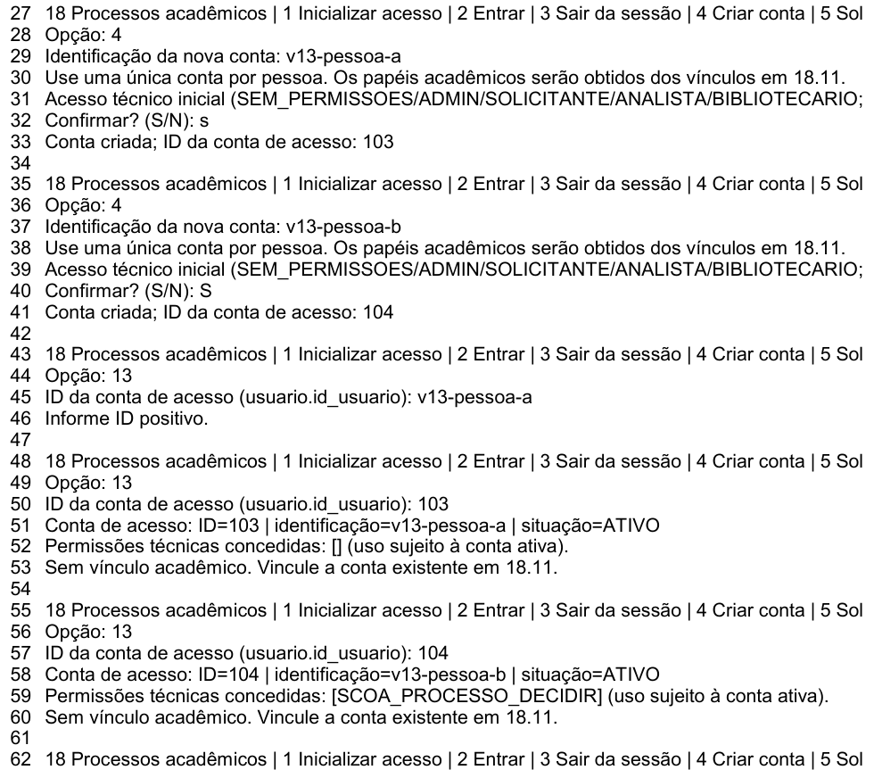
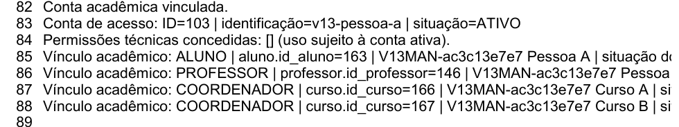
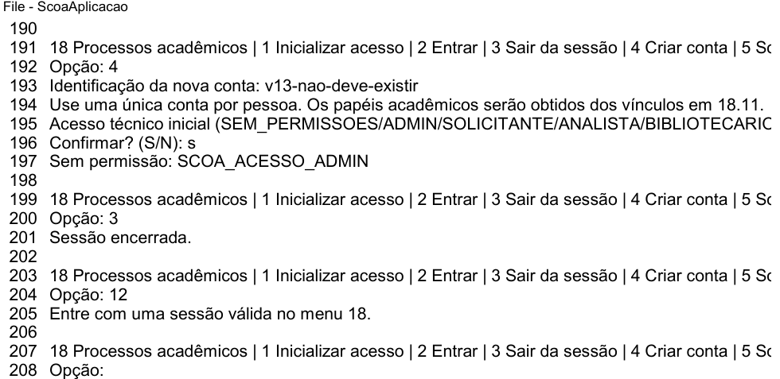
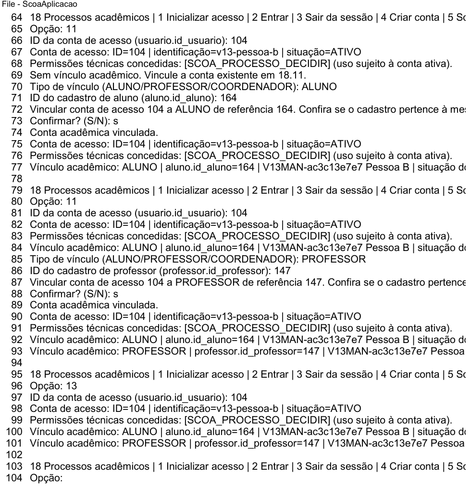
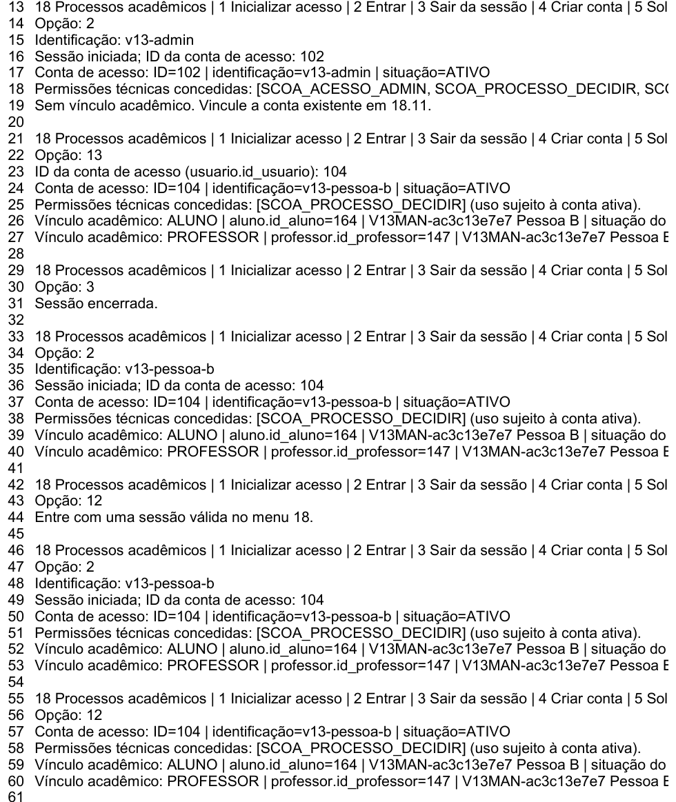
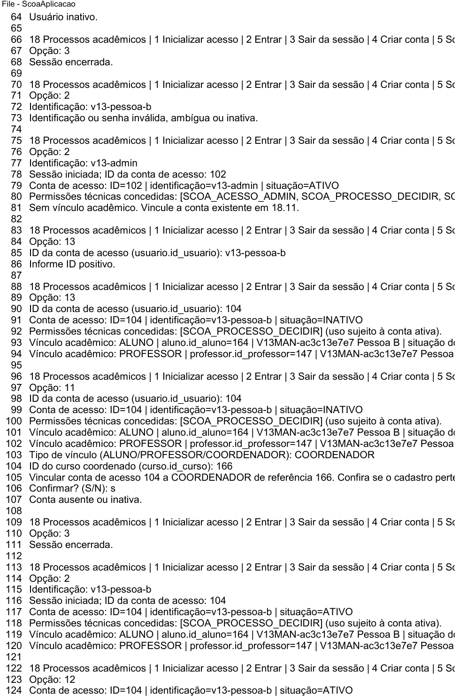

# Capturas reais da validação v0.13

Seleção da execução manual do autor em 23 e 24/11/2026, com dados sintéticos. Os seis casos estão detalhados no [relatório](RELATORIO.md). As imagens são recortes de páginas de console impressas pelo IntelliJ; preservam o texto original. Algumas linhas extensas já estavam limitadas à largura da impressão original. Os CSVs complementam os registros.

## V13 01 Contas sem vínculo

Criação de A com SEM_PERMISSOES e de B como ANALISTA; consultas mostram a separação entre conta, vínculo e permissão. A entrada textual em campo de ID é recusada e corrigida pelo autor.

Origem: V13_01_contas_sem_vinculo.pdf, página 1. Apoio: [perfis](dados/V13_01_perfis.csv) e [permissões](dados/V13_01_permissoes.csv).

## V13 02 Vários vínculos

Uma conta reúne aluno, professor e coordenação de dois cursos e continua sem permissões técnicas. A repetição preservou os cinco eventos, comprovada pela igualdade das exportações antes e depois.

Origem: V13_02_multiplos_vinculos.pdf, página 2. Apoio: [vínculos](dados/V13_02_vinculos.csv), [eventos](dados/V13_02_eventos.csv) e [preservação](dados/V13_02_preservacao.csv).

## V13 03 Recusas de administração

A tentativa de criar ADMIN pela conta A é recusada; consulta sem sessão também é recusada.

Origem: V13_03_identidade_e_recusas.pdf, página 4. Apoio: [contas indevidas](dados/V13_03_recusas.csv) e [ausência de concessões](dados/V13_03_sem_concessoes.csv).

## V13 04 Cadastros e concessões preservados

B recebe seus cadastros de aluno e professor e mantém apenas SCOA_PROCESSO_DECIDIR. As recusas de tomada de cadastros constam do original e do relatório.

Origem: V13_04_protecao_e_acesso_tecnico.pdf, página 2. Apoio: [alunos](dados/V13_04_alunos.csv), [professores](dados/V13_04_professores.csv), [permissões](dados/V13_04_permissoes.csv) e [credenciais preservadas](dados/V13_04_credenciais_preservadas.csv).

## V13 05 Perfil legado

B apresenta somente os vínculos efetivos de aluno e professor. O rótulo legado COORDENADOR, preparado por SQL, não cria vínculo com curso.

Origem: V13_05_legado.pdf, página 1. Apoio: [perfil preservado](dados/V13_05_perfil_legado.csv), [zero cursos coordenados](dados/V13_05_sem_coordenacao.csv) e [eventos](dados/V13_05_eventos_preservados.csv).

## V13 06 Inativação e retorno

Consulta, login e novo vínculo são recusados com a conta inativa. Após restauração SQL da fixture, B autentica novamente. Essas mudanças de situação não são operações auditadas do console.

Origem: V13_06_retorno_ativo.pdf, página 2. Apoio: [contas finais](dados/V13_06_contas_finais.csv), [coordenação](dados/V13_06_coordenacao_final.csv), [credenciais](dados/V13_06_preservacao_final.csv) e [eventos finais](dados/V13_06_eventos_finais.csv).

## Rastreabilidade

O [manifesto da seleção](SELECAO_PUBLICA.json) registra fonte, página, recorte e hashes de cada imagem ou CSV publicado. O [manifesto dos 90 originais](MANIFESTO_SHA256.json) identifica a rodada completa. Originais PDF, XMLs brutos, configurações e credenciais permanecem privados.
