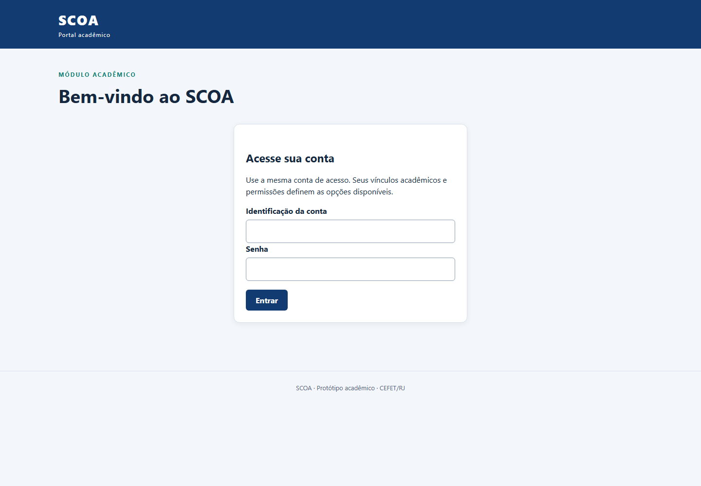
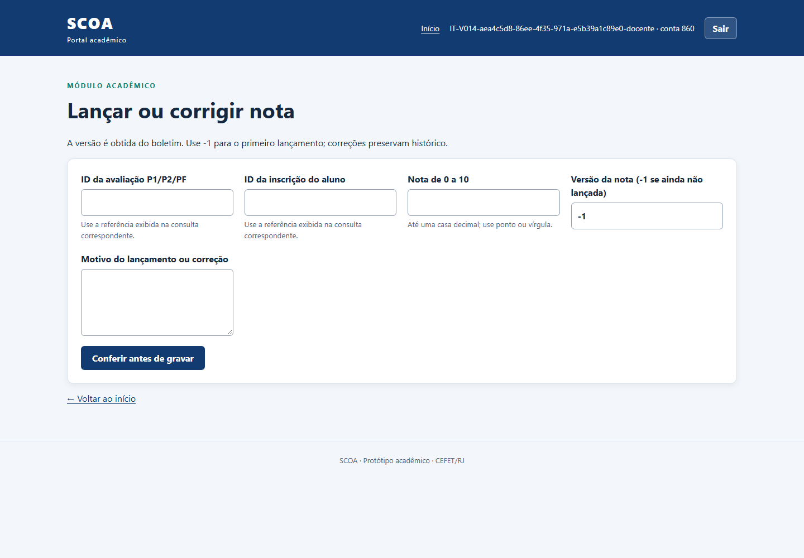

# Amostras visuais sintéticas do protótipo

Seleção de duas páginas do PDF **sintético gerado no teste automatizado do Codex**, em 25/11/2026. Não são capturas dos testes manuais do autor nem registros de uma turma real. O caso contém 48 registros, a nota zero, campos sem lançamento, acentos e texto extenso; o PDF tem sete páginas.

O teste `ExportadorRelatorioAcademicoTest.pdfRealPreservaAcentosValoresEPaginasAteUltimoRegistro` extrai o texto e verifica os 48 marcadores, inclusive o último, além de gerar as imagens abaixo para conferência visual. A planilha é reaberta por testes separados, que verificam valores e textos que parecem fórmulas sem executá-los.

## Primeira página

## Última página

Os originais PDF/XLSX, os demais relatórios e as tentativas anteriores permanecem privados, identificados por manifesto. A [seleção pública](AMOSTRAS.json) registra os hashes destas imagens. [Resultados e limites da validação](RELATORIO.md).

## Portal acadêmico local

Três telas selecionadas do HTML retornado pelos testes HTTP da execução de 25/11/2026 16:56:19 UTC-03. Renderização posterior com Microsoft Edge em modo headless e dimensões explícitas de viewport; não houve corte/edição das imagens. Larguras de viewport, área do documento e conteúdo foram conferidas como iguais, sem transbordamento horizontal, inclusive em 390 pixels. A largura estreita é uma simulação de apresentação, não teste de aparelho físico.

Estas imagens demonstram a apresentação de dados sintéticos. A validação das operações é a dos testes HTTP/JDBC; a renderização não é registrada como teste de interação completa no navegador nem como rodada manual do autor. Uma tentativa inicial de captura com Chrome não produziu imagem; não foi contabilizada como validação desse navegador. Chrome e Firefox permanecem para a conferência manual prevista.

### Entrada

### Área do aluno em largura estreita

### Formulário docente

Os hashes, as fontes e a identificação da execução de cada tela estão no [manifesto de seleção](AMOSTRAS.json), separados das duas páginas PDF da execução anterior. HTML original e demais evidências de renderização permanecem privados.
