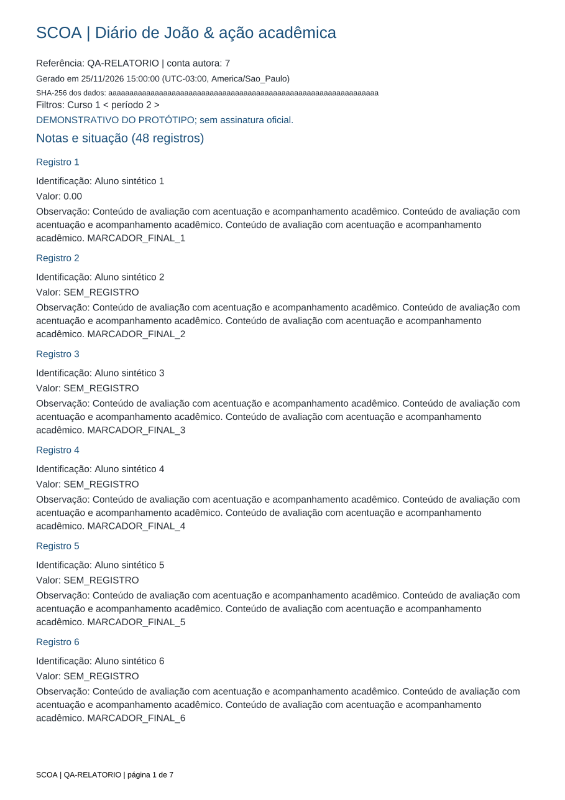
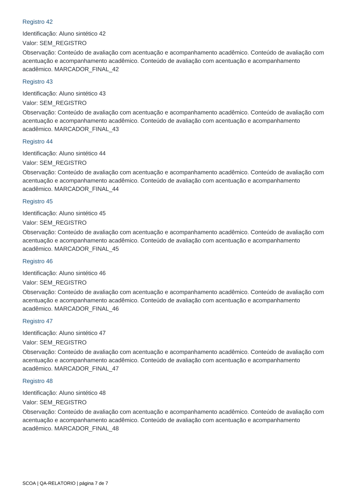

# Amostras visuais da exportação acadêmica

Seleção de duas páginas do PDF **sintético gerado no teste automatizado do Codex**, em 25/11/2026. Não são capturas dos testes manuais do autor nem registros de uma turma real. O caso contém 48 registros, a nota zero, campos sem lançamento, acentos e texto extenso; o PDF tem sete páginas.

O teste `ExportadorRelatorioAcademicoTest.pdfRealPreservaAcentosValoresEPaginasAteUltimoRegistro` extrai o texto e verifica os 48 marcadores, inclusive o último, além de gerar as imagens abaixo para conferência visual. A planilha é reaberta por testes separados, que verificam valores e textos que parecem fórmulas sem executá-los.

## Primeira página

## Última página

Os originais PDF/XLSX, os demais relatórios e as tentativas anteriores permanecem privados, identificados por manifesto. A [seleção pública](AMOSTRAS.json) registra os hashes destas imagens. [Resultados e limites da validação](RELATORIO.md).
